# System Architecture: Publisher to Word

> **Audience:** System Architects, Lead Engineers, UI/UX Designers  
> **Status:** Phase 1 Foundation Active

---

## 1. Architectural Philosophy

The *Publisher to Word* tutorial website is designed with a fundamental principle: **maximum calm, zero bloat, and total resilience**.

Many tutorial websites overwhelm learners with cookie banners, newsletter overlays, heavy JavaScript single-page application (SPA) bundles, and slow font rendering. Because our audience includes users who find technology challenging or intimidating, the system is engineered from the ground up as a **static Multi-Page Application (MPA)** using **Astro 5** and standard modern web platform APIs.

### Key Architectural Tenets:
1. **Zero Client-Side Framework Overhead:** No React, Vue, or heavy client runtime is shipped to the browser. Interactive features use native HTML and CSS first, augmented by lightweight vanilla JavaScript progressive enhancements.
2. **Accessible Native Web Platform First:** We align with Google's `modern-web-guidance` skill recommendations. We favour native elements (`<details>`, `popover`, CSS Anchor Positioning, Container Queries, `@view-transition`) over custom script-heavy abstractions.
3. **Strict Content Modelling via Content Collections:** All lesson content is authored in MDX, validated against strict TypeScript/Zod schemas at build time, preventing runtime layout errors or missing frontmatter fields.
4. **Resilient Static Compilation:** The output in `dist/` consists of standalone, pre-rendered HTML, CSS, and SVG files. It can be hosted on any static web server with zero database or server runtime dependencies.

---

## 2. High-Level System Architecture

The diagram below illustrates how content, data models, components, layouts, and styles are combined at build time by Astro to produce the final static website:

```mermaid
flowchart TD
  subgraph DataContent["Content & Data Layer"]
    MDX["src/content/lessons/*.mdx<br/>(Markdown + Lesson Content)"]
    Config["src/content.config.ts<br/>(Zod Type Schema)"]
    Curriculum["src/data/curriculum.ts<br/>(Master 4-Module Catalog)"]
    Translator["src/data/translator.ts<br/>(Publisher → Word Lookup)"]
  end

  subgraph DesignSystem["Design System (CSS)"]
    Tokens["src/styles/tokens.css<br/>(Light-Only Palette, Clamp Scales, High Contrast)"]
    Base["src/styles/base.css<br/>(Reset, Typography, A11y, View Transitions)"]
    Components["src/styles/components.css<br/>(Cards, Disclosures, Buttons, Badges)"]
    Print["src/styles/print.css<br/>(@media print Stylesheet)"]
  end

  subgraph ComponentLayer["Astro Component Hierarchy"]
    BaseLayout["src/layouts/BaseLayout.astro<br/>(Shell, Landmarks, Skip Link, Header, Footer)"]
    LessonLayout["src/layouts/LessonLayout.astro<br/>(2-Col Grid, Sidebar, PrevNext)"]
    NavComponents["src/components/nav/*<br/>(SiteHeader, SiteFooter, LessonSidebar, PrevNextNav)"]
    TeachingComponents["src/components/teaching/*<br/>(WhereToFindIt, PublisherCompare, StepList, GotchaBox, MacNote)"]
    Simulators["src/components/interactive/*<br/>(Wrap, Anchor, Margin & Align Simulators)"]
  end

  subgraph PagesLayer["Page Routing (src/pages/)"]
    Home["index.astro (/)"]
    StartHere["start-here.astro (/start-here)"]
    LessonDir["lessons/index.astro (/lessons)"]
    LessonSlug["lessons/[...slug].astro (/lessons/[slug])"]
    TranslatorPage["translator.astro (/translator)"]
    RescuePage["rescue.astro (/rescue)"]
    ProjectsPage["projects/index.astro (/projects)"]
    CheatSheetPage["cheat-sheet.astro (/cheat-sheet)"]
  end

  subgraph OutputLayer["Production Static Distribution (dist/)"]
    DistHTML["Static HTML Pages<br/>(8 Pre-rendered Routes)"]
    DistAssets["Static Assets<br/>(Optimized CSS, Bundled JS, SVG Favicon)"]
    DistSitemap["sitemap-index.xml & sitemap-0.xml"]
  end

  MDX --> Config
  Config --> LessonSlug
  Curriculum --> Home
  Curriculum --> LessonDir
  Curriculum --> LessonSlug
  Curriculum --> NavComponents

  Tokens --> BaseLayout
  Base --> BaseLayout
  Components --> BaseLayout
  Print --> BaseLayout

  NavComponents --> BaseLayout
  TeachingComponents --> LessonSlug
  Simulators --> LessonSlug

  BaseLayout --> Home
  BaseLayout --> StartHere
  BaseLayout --> LessonDir
  BaseLayout --> TranslatorPage
  BaseLayout --> RescuePage
  BaseLayout --> ProjectsPage
  BaseLayout --> CheatSheetPage

  BaseLayout --> LessonLayout
  LessonLayout --> LessonSlug

  Home --> DistHTML
  StartHere --> DistHTML
  LessonDir --> DistHTML
  LessonSlug --> DistHTML
  TranslatorPage --> DistHTML
  RescuePage --> DistHTML
  ProjectsPage --> DistHTML
  CheatSheetPage --> DistHTML
  DesignSystem --> DistAssets
```



---

## 3. Data Flow & Routing Pipeline

### Content Collections (`src/content.config.ts`)
Astro 5's Content Collections API uses the `glob` loader to ingest and validate MDX files:

```ts
const lessons = defineCollection({
  loader: glob({ pattern: '**/*.{md,mdx}', base: './src/content/lessons' }),
  schema: z.object({
    title: z.string(),
    module: z.number(),
    moduleTitle: z.string(),
    order: z.number(),
    summary: z.string(),
    wordTabs: z.array(z.string()).default([]),
    hasMacNotes: z.boolean().default(false),
  }),
});
```

### Master Catalog (`src/data/curriculum.ts`)
While individual MDX files supply the content of available lessons, `src/data/curriculum.ts` holds the master catalog of all 14 lessons across 4 modules. This ensures:
- The `LessonSidebar` and curriculum listings render the complete course structure from day one.
- Future lessons can be marked `isAvailable: false` (displaying a calm *"Coming in Phase 3"* badge).
- The `getAdjacentLessons(slug)` helper reliably calculates Previous and Next lesson metadata regardless of MDX file ordering.

---

## 4. Design System Architecture: *Calm Stationery*

### Strict Light-Mode Policy
The website enforces `color-scheme: light` on the root element. This design choice mirrors the familiar white-paper sheet inside Microsoft Publisher and Word, creating a serene, glare-free, and predictable reading experience.

### Colour Tokens (`src/styles/tokens.css`)
All colours meet or exceed WCAG AA/AAA minimum contrast standards:
- `--surface-page` (`#FAF9F6`): Warm off-white paper canvas.
- `--surface-card` (`#FFFFFF`): Pure white elevated card surfaces.
- `--ink-primary` (`#1E293B`): Deep slate body text ($\approx 14:1$ contrast against `#FAF9F6`).
- `--ink-secondary` (`#475569`): Muted slate for captions and secondary text ($\approx 7:1$ contrast).
- `--border-ui` (`#94A3B8`): Structural boundary for buttons and inputs ($\ge 3:1$ contrast against white).
- `--accent-word` (`#1D4ED8`): Word-inspired blue for primary interactive elements ($\approx 6.5:1$ contrast).
- `--accent-publisher` (`#0F766E`): Publisher-inspired teal for comparison callouts ($\approx 5.4:1$ contrast).
- `--accent-tip` (`#B45309`): Warm amber for "Watch Out" gotchas ($\approx 5.0:1$ contrast).
- `--accent-success` (`#15803D`): Forest green for "Try It" exercises ($\approx 5.2:1$ contrast).

### Windows Forced Colours Mode (High Contrast)
In accordance with modern accessibility practices (`color` guide), all visual boundaries and states adapt under `@media (forced-colors: active)` using system keywords:
```css
@media (forced-colors: active) {
  :root {
    --surface-page: Canvas;
    --surface-card: Canvas;
    --ink-primary: CanvasText;
    --border-ui: ButtonText;
    --border-focus: Highlight;
    --accent-word: Highlight;
  }
}
```

### Fluid Typography System (`typography` guide)
- All font sizes use `rem` units (never `px`) so user browser default font size preferences are respected.
- Fluid heading scales use bounded CSS `clamp()` where `max <= 2.5 * min` (e.g. `clamp(1.75rem, 1.35rem + 1.8vw, 2.75rem)`). This ensures WCAG 1.4.4 (200% text zoom) reflows smoothly without truncation.
- Prose width is capped at `max-inline-size: 60ch` ($\approx 70\text{--}80$ characters per line) for optimal reading comfort.
- Headings use `text-wrap: balance` and body paragraphs use `text-wrap: pretty`.

---

## 5. Modern Web Platform Integration (`modern-web-guidance`)

The application integrates key patterns from Google's `modern-web-guidance` skill:

### 1. Content-Aware Navigation Bar (`navbar`)
Instead of an arbitrary pixel breakpoint, `SiteHeader.astro` uses a `ResizeObserver` measuring whether the inline row fits (`scrollWidth <= clientWidth`). When it fits, items render inline; when space is tight or the user zooms text, it automatically switches to a native `<ul popover="auto">` menu triggered by a `<button popovertarget="site-menu">`. A feature-detected polyfill loader (`@oddbird/popover-polyfill`) ensures older browsers still function seamlessly.

### 2. Zero Noise & Scroll-State Header Auto-Hide (`content-first-noise-reduction`)
To give visual learners maximum vertical space while reading, the header automatically hides when scrolling down and returns instantly on scroll up using CSS scroll-state container queries:
```css
html { container-type: scroll-state; }

@container scroll-state((scrolled: bottom) and (scrollable: top)) {
  .site-header { transform: translateY(-100%); }
}

.site-header:focus-within { transform: none !important; }
```
A passive scroll event listener acts as a fallback for browsers that do not yet support scroll-state container queries.

### 3. Accessible Native Disclosures (`accordion`, `search-hidden-content`)
All troubleshooting items in `/rescue` and collapsible callouts use native `<details class="disclosure">`:
- No `<h1>`–`<h6>` headings are placed inside `<summary>` (preventing JAWS and TalkBack from dropping heading roles).
- Custom chevrons use masked SVG pseudo-elements (`::before`) placed **immediately before** the summary text.
- Progressive opening animation is handled via CSS `interpolate-size: allow-keywords` and `::details-content`.
- Closed content remains searchable via native browser Find-in-Page (<kbd>Ctrl</kbd> + <kbd>F</kbd>).

### 4. Cross-Document View Transitions (`cross-document-transitions`)
Astro static pages opt into native MPA view transitions:
```css
@media (prefers-reduced-motion: no-preference) {
  @view-transition { navigation: auto; }
}
```
This delivers a smooth, calm transition between tutorial pages without shipping any client-side SPA router.

---

## 6. Build & Packaging Architecture

- **Static Generation (`astro build`):** Generates static files in `dist/`.
- **CSS Strategy:** Global tokens and shared base styles are loaded in `BaseLayout.astro`. Component styles are scoped by Astro with `scopedStyleStrategy: 'where'` (low specificity, allowing easy composition).
- **Tooling Integration:** ESLint (flat config with Astro and JSX-A11y plugins), Stylelint (HTML/Astro CSS parser), and an automated verification script (`scripts/verify-dist.mjs`) work together in `npm run quality`.
