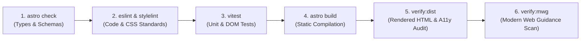

# Testing & Quality Assurance Guide: Publisher to Word

> **Audience:** QA Engineers, Testers, Maintainers, and Contributors  
> **Status:** Phase 1 Foundation Active

---

## 1. Quality Assurance Philosophy

Because *Publisher to Word* is designed for learners who may already feel anxious about technology, software bugs, broken links, illegible text, or clunky navigation are treated as critical defects.

Our QA pipeline consists of two tiers:
1. **Automated Quality Gate (`npm run quality`):** Runs on every commit attempt via a Git pre-commit hook, validating syntax, types, rendered HTML integrity, accessibility rules, and modern web standards.
2. **Manual Accessibility & Device Protocol:** Systematic testing for keyboard focus, 200% text zoom reflow, screen readers, and print layouts.

---

## 2. Automated Quality Gate (`npm run quality`)

Running `npm run quality` executes six distinct verification engines in sequence (~4 seconds total):



### Stage 1: Astro & TypeScript Type Checking (`npm run check`)
- Runs `astro check --minimumFailingSeverity hint`.
- Validates all frontmatter in `src/content/lessons/*.mdx` against the Zod schema in `src/content.config.ts`.
- Validates TypeScript props and types across all `.astro` and `.ts` files.
- **Passing condition:** `0 errors, 0 warnings, 0 hints`.

### Stage 2: Code & Style Linting (`npm run lint`)
- **`npm run lint:eslint` (`eslint . --max-warnings 0`):** Uses ESLint flat config with `eslint-plugin-astro`, `@typescript-eslint/parser`, and `eslint-plugin-jsx-a11y-x`. Enforces semantic HTML, ARIA rules, and TypeScript best practices, failing on any warning.
- **`npm run lint:stylelint` (`stylelint "src/**/*.{css,astro}" --max-warnings 0`):** Uses `stylelint-config-standard` and `stylelint-config-html` to lint global CSS and inline `<style>` tags in Astro components. Enforces modern CSS syntax (e.g. space-separated `rgb(0 0 0 / 10%)`), logical properties (`margin-block`), and property validation, failing on any warning.
- **Passing condition:** `0 errors, 0 warnings`.

### Stage 3: Unit & DOM Controller Testing (`npm run test`)
- Runs `vitest run --coverage`.
- Executes unit tests for utility functions (e.g. `src/utils/id.ts`) and DOM controller tests for interactive simulators (`src/utils/simulator-controllers.ts`) using `linkedom`.
- Verifies state transitions, live region announcements, keyboard arrow cycling, and graceful degradation on partial DOM elements.
- Enforces strict coverage gates (minimum 85% lines, statements, and functions, 80% branches).
- **Passing condition:** All test suites pass and meet or exceed coverage thresholds.

### Stage 4: Static Compilation (`npm run build`)
- Runs `astro build`.
- Generates pre-rendered HTML files and static assets into `dist/`.
- Generates `sitemap-index.xml` and `sitemap-0.xml`.
- **Passing condition:** Successful exit code with all expected routes generated.

### Stage 5: Rendered Static HTML & Link Audit (`npm run verify:dist`)
- Runs `node scripts/verify-dist.mjs`.
- Inspects every compiled `.html` file in `dist/` directly to catch runtime defects that linters cannot see.

### Stage 6: Modern Web Platform Scanner (`npm run verify:mwg`)
- Runs `node scripts/verify-mwg.mjs` (wrapping `modern-web-guidance legacy-scan src --json`).
- Scans `src/` against 35 deterministic rules across 33 guides from Google's `modern-web-guidance` knowledge base to ensure no deprecated or legacy web patterns are introduced.
- **Passing condition:** `totalFindings: 0` (the script exits non-zero if any legacy patterns are discovered).

---

## 3. Deep Dive: `scripts/verify-dist.mjs`

Standard linters only examine isolated source files. `scripts/verify-dist.mjs` audits the actual compiled HTML output in `dist/` as a coherent website.

### What `verify-dist.mjs` Tests:

| Category | Invariant Checked | Why It Matters |
| :--- | :--- | :--- |
| **Link Integrity** | Zero broken internal `href` links. | Ensures every route link (e.g. `/start-here`, `/lessons/01-how-text-flows`) resolves to an actual page in `dist/`. |
| **Anchor Integrity** | Zero missing `#anchor` targets. | Confirms every in-page anchor (e.g. `href="#content"` or `href="/lessons#module-2"`) matches a real `id` on the target page. |
| **Landmark Invariants** | Exactly one `<main id="content">` per page. | Required by WCAG 1.3.1 so screen reader users can immediately jump to primary content. |
| **Skip Links** | Skip link to `#content` present. | Required by WCAG 2.4.1 so keyboard users can bypass repetitive navigation bars. |
| **Heading Structure** | Exactly one `<h1>` per page. | Ensures logical document outlines without confusing screen reader users. |
| **Summary Disclosures** | Zero headings (`<h1>`–`<h6>`) inside `<summary>`. | Mandated by `modern-web-guidance`: screen readers like JAWS and TalkBack treat `<summary>` as a button and drop headings inside it. |
| **SVG Accessibility** | Every `<svg>` has `aria-hidden="true"` OR `role="img"` with accessible name. | Decorative icons must not clutter screen readers; informative diagrams must have descriptions. |
| **Image Accessibility** | Every `` has `alt` (no clichés). | Flags missing alt tags and bans clichéd prefixes like *"Image of..."* or *"Picture of..."*. |
| **Popover Integrity** | `popovertarget="id"` matches a real element. | Ensures native popovers never point to non-existent IDs. |
| **Focus Safety** | Zero positive `tabindex` attributes. | Positive tabindex disrupts natural tab order and creates disorienting navigation jumps. |

---

## 4. Manual Accessibility & UX Testing Protocol

In addition to automated testing, maintainers and QA testers perform the following manual checks on key pages before major milestone releases:

### 1. Keyboard-Only Navigation
- **Tool:** Physical keyboard (mouse/trackpad disconnected).
- **Procedure:**
  1. Press <kbd>Tab</kbd> immediately after page load. Verify the **Skip to main content** link appears prominently at top-left.
  2. Press <kbd>Enter</kbd> on the skip link. Verify keyboard focus moves directly to the main landmark `<main id="content">`, and subsequent keyboard navigation continues into the main content.
  3. Continue tabbing through the page. Verify every link, button, and disclosure displays a crisp high-contrast outline (`3px solid var(--border-focus)`).
  4. Activate a `<details class="disclosure">` item with <kbd>Enter</kbd> or <kbd>Space</kbd>. Confirm it opens and closes smoothly.
  5. In narrow viewports, open the **Menu** popover using <kbd>Enter</kbd>. Press <kbd>Esc</kbd> to confirm light-dismiss works.

### 2. 200% Text Zoom & Reflow (WCAG 1.4.4 & 1.4.10)
- **Tool:** Browser zoom (<kbd>Ctrl</kbd> + <kbd>+</kbd> / <kbd>Cmd</kbd> + <kbd>+</kbd>) set to **200%**, and viewport set to **320 CSS px width**.
- **Expected Outcome:**
  - No horizontal scrollbars appear on body text or prose.
  - The navigation bar gracefully collapses to the native popover button without clipping.
  - Text inside buttons, cards, and callout boxes does not truncate or overlap.

### 3. Native Find-in-Page (<kbd>Ctrl</kbd> + <kbd>F</kbd>)
- **Procedure:**
  1. Navigate to `/rescue`.
  2. With all troubleshooting accordions closed, press <kbd>Ctrl</kbd> + <kbd>F</kbd> and search for a keyword inside a closed section (e.g. `"Selection Pane"`).
  3. Confirm the browser highlights the text and automatically expands the parent `<details>` element.

### 4. Windows Forced Colours Mode (High Contrast)
- **Tool:** Chrome / Edge DevTools → *Rendering* tab → *Emulate CSS media feature forced-colors: active*.
- **Expected Outcome:**
  - Page background switches to system `Canvas`, body text to `CanvasText`.
  - Borders and buttons switch to `ButtonText` / `Highlight`.
  - The active page indicator in the header and sidebar remains clearly visible via system colour outlines/borders.

### 5. Print Layout Verification (`@media print`)
- **Procedure:**
  1. Navigate to any lesson (e.g. `/lessons/01-how-text-flows`) or `/cheat-sheet`.
  2. Open Print Preview (<kbd>Ctrl</kbd> + <kbd>P</kbd> / <kbd>Cmd</kbd> + <kbd>P</kbd>).
  3. Verify:
     - Navigation headers, footers, and sidebars are completely hidden.
     - Background is pure white `#FFFFFF` and text is solid `#000000`.
     - Cards do not suffer awkward mid-card page splits (`break-inside: avoid`).
     - Disclosures in `/rescue` expand automatically to show troubleshooting advice.

---

## 5. Git Pre-Commit Hook

The automated quality gate is enforced by Git via the tracked repository hook `.githooks/pre-commit`, configured automatically on `npm install` via `npm run prepare`:

```sh
#!/usr/bin/env sh
echo "🛡️  Running Publisher-to-Word Quality Gate..."
npm run quality
```

If any check fails:
1. The commit is rejected immediately with a descriptive error log.
2. The developer fixes the reported issue.
3. Once `npm run quality` passes with 0 errors and 0 warnings, the commit succeeds.

---

## 6. End-to-End (E2E) Browser Testing Recommendations (Future Phase)

### Current Architecture & Boundary
Unit tests in Vitest with `linkedom` (`tests/simulators-dom.test.ts`) exercise client controllers extracted into TypeScript modules (`src/utils/simulator-controllers.ts`). This provides fast, zero-dependency CI validation for:
- Simulator state transitions and radio interactions.
- ARIA live region status messaging and attribute synchronization.
- Keyboard arrow cycling (<kbd>ArrowDown</kbd>, <kbd>ArrowUp</kbd>, <kbd>ArrowRight</kbd>, <kbd>ArrowLeft</kbd>).
- Graceful degradation when optional DOM nodes are absent.

### Recommended Playwright E2E Suite
To complement LinkeDOM unit tests and catch regressions that only emerge in actual browser rendering engines, future project phases should introduce a lightweight Playwright E2E suite:

1. **Astro Client Script Bundling:** Verify that client `<script>` bundles produced by Vite/Astro execute and bind events correctly in real Chromium, Firefox, and WebKit instances.
2. **CSS Anchor Positioning (`UiHotspotMap.astro`):** Smoke-test native CSS anchor positioning (`anchor-name`, `position-anchor`, `@position-try`) in Chromium alongside fallback popover behaviour in Firefox and WebKit.
3. **Multi-Instance Isolation:** Verify that multiple simulator instances on a single page maintain independent state without DOM query collisions.
4. **Visual Regression & Layout Invariants:** Automated screenshot diffs for 320 CSS px reflow, high-contrast mode, and print media emulation.
